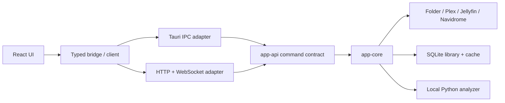

<p align="center">
  
</p>

<p align="center">
  Karaoke from any song in your music library, powered by neural networks.
</p>

<p align="center">
  <a href="LICENSE"></a>
</p>

<p align="center">
  <a href="CHANGELOG.md">Changelog</a> ·
  <a href="https://nightingale.cafe/docs/">User guide</a>
</p>

---

Nightingale turns music you already have into karaoke. It can separate lead vocals, find or produce word-timed lyrics, and play tracks with synchronized highlighting, pitch scoring, key and tempo controls, multiplayer, and dynamic backgrounds. This fork runs it as a self-hosted Windows web app: one batch file starts the server, your browser is the client.

## How this fork differs from upstream

Forked from [rzru/nightingale](https://github.com/rzru/nightingale). Everything else tracks upstream; the differences are:

- **Note Highway vocal trainer** — a Joysound-style practice view built on the live pitch scoring: scrolling target notes, glowing mic trace, PERFECT/GREAT/GOOD/MISS judgments with combo multiplier and running score, and a live D–SSS grade badge. Best scores are saved per song and shown as badges in the library.
- **YouTube song import** — search or paste a link and yt-dlp downloads the song as MP3 into your folder library: artist and cover art are auto-filled, and the caption track you pick (in the audio's own language) becomes synced lyrics with CJK readings. Sign in with a `yt_cookies.txt` cookie file or an installed browser — no QR-code queue. For imported songs, **Refresh metadata** and **Refetch lyrics & align** also work against the live video (updated title/cover art, re-pulled captions).
- **Windows self-hosted setup** — `update.bat` builds client + server, `run.bat` starts the server on `127.0.0.1:64500`, and all data lives in `%USERPROFILE%\.nightingale-fork`. Also fixes delete-song on Windows (canonical path comparison).
- **Docker/Linux ffmpeg** — the vendored ffmpeg downloads BtbN GitHub release builds; the upstream URL returns anti-bot HTML inside containers.

## Highlights

- **Bring your library** — scan local audio, video, and UltraStar files, or connect Plex, Jellyfin, or Navidrome. Existing provider and folder playlists appear as read-only navigation.
- **Import from YouTube** — search or paste a link to download songs as MP3 into your folder library: cover art and metadata are embedded, the uploader becomes the artist, and the caption track you pick (with language selection) becomes synced lyrics with CJK readings. Sign in with a `yt_cookies.txt` cookie file or an installed browser to clear bot checks.
- **Prepare tracks locally** — separate vocals with UVR Karaoke or Demucs, then use LRCLIB, local or pasted LRC, or automatic transcription and alignment for lyrics.
- **Sing your way** — follow synchronized lyrics, score microphone pitch, adjust key and tempo, mix guide vocals, monitor the microphone, and compensate for room latency.
- **Train on the Note Highway** — a dedicated Joysound-style practice view built on the live pitch scoring: scrolling target notes, glowing mic trace, PERFECT/GREAT/GOOD/MISS judgments, combo multiplier, and a live D–S grade badge.
- **Run a karaoke night** — build a playback queue, keep managing it during Session mode, switch profiles, compare scoreboards, or assign separate microphones to two to four local players.
- **Set the stage** — use source video, GPU shaders, Pixabay loops, or custom image, video, and shader backgrounds; reposition and scale lyrics and the pitch graph.
- **Use the screen you have** — keyboard, gamepad, touch, and layouts ranging from phones to 4K displays.

Detailed behavior, supported media formats, controls, analyzer options, and current limitations live in the [user guide](https://nightingale.cafe/docs/).

## Run it (Windows)

The only supported setup is `run.bat` — no Docker, no desktop app, no system dependencies.

```bat
git clone https://github.com/LeonidasTMT/nightingale.git
cd nightingale
update.bat   :: build client + server (release)
run.bat      :: start the server on http://127.0.0.1:64500
```

Then open `http://127.0.0.1:64500`.

- All data lives in `%USERPROFILE%\.nightingale-fork` — library database, profiles, scores, vendored tools, and `yt_cookies.txt`. Nothing is written outside the repository except that folder and the build output in `target/`.
- First launch prepares an isolated copy of ffmpeg, Python, the analyzer packages, and required ML models. No system Python setup is needed, but the initial download is several gigabytes.
- GPU acceleration is optional; analysis falls back to CPU when CUDA is unavailable.
- Closing the console window stops the server. To update, close the window, `git pull`, run `update.bat` again.

## Documentation

- [Library sources](https://nightingale.cafe/docs/library-sources.html) and [Import From YouTube](site/src/content/docs/docs/youtube-import.md)
- [Lyrics and transcription](https://nightingale.cafe/docs/lyrics.html)
- [Controls](https://nightingale.cafe/docs/controls.html)
- [Scoring](https://nightingale.cafe/docs/scoring.html), [Vocal Trainer](site/src/content/docs/docs/vocal-trainer.md) and [multiplayer](https://nightingale.cafe/docs/multiplayer.html)
- [Backgrounds](https://nightingale.cafe/docs/backgrounds.html)

## Architecture

Desktop and self-hosted delivery share one Rust application core and one React frontend. Transport adapters stay thin so karaoke behavior does not diverge between Tauri and the web server.



The analyzer runs as a persistent local process over token-authenticated loopback IPC, avoiding model startup cost for every song. Analysis artifacts are cached by BLAKE3 source hash, so unchanged tracks reuse stems, transcripts, lyrics, and shifted playback variants.

### Repository layout

| Path | Responsibility |
| --- | --- |
| `app-core/` | Shared application behavior, source adapters, persistence, media serving, analyzer orchestration, and analyzer scripts |
| `app-api/` | Shared command contract, dispatch, state, events, and error classification |
| `client/src/` | React interface, feature modules, typed runtime bridge, playback, and microphone processing |
| `client/src-tauri/` | Tauri desktop adapter and native capabilities |
| `client/src-server/` | Axum HTTP/WebSocket adapter and embedded web bundle |
| `site/` | Astro website and mdBook user guide |
| `docker/`, `scripts/` | Container and bare-metal self-hosted distribution |

## Development

### Prerequisites

| Tool | Version |
| --- | --- |
| Rust | 1.94.1, pinned by `rust-toolchain.toml` |
| Node.js | 22.12 or newer |
| pnpm | 11.2.2 |

`update.bat` builds the client and server (release) using those tools, and `run.bat` starts the self-hosted server on `127.0.0.1:64500` with data in `%USERPROFILE%\.nightingale-fork`.

Before submitting changes, run the repository checks:

```bash
pnpm --dir client format
pnpm --dir client quality
```

## License

GPL-3.0-or-later — see [LICENSE](LICENSE).
